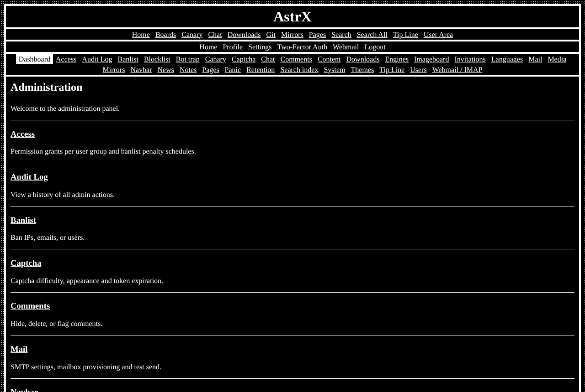

# astrx/cms

The always-on content-management features of [AstrX](https://github.com/Vxmdzhb/astrx):
accounts (registration, login, two-factor, recovery, profiles), the admin panel
(users, grants, pages, navigation, themes, configuration, audit log, panic
lockdown), comments, news, invites and data retention.



It also defines the extension points optional modules answer
(`Retention\RetentionSource`, `Page\SitemapSource`, `User\LoginListener`,
`User\UserHomeSection`, `Admin\AdminDashboardSection`; see
[modules](https://github.com/Vxmdzhb/astrx/blob/main/docs/MODULES.md)).

`resources/` holds the admin and account templates, their catalogs (en, it),
the diagnostic messages and the default configuration. A site overrides any of
them from its own `resources/`.

Requires `astrx/framework` and `astrx/library`.

AstrX isn't on Packagist and doesn't tag versions: you install from each
repository's `main`, and your `composer.lock` pins the exact commit. Tell
Composer where to find the package and the AstrX packages it depends on:

```json
{
    "minimum-stability": "dev",
    "prefer-stable": true,
    "repositories": [
        { "type": "vcs", "url": "https://github.com/Vxmdzhb/cms" },
        { "type": "vcs", "url": "https://github.com/Vxmdzhb/framework" },
        { "type": "vcs", "url": "https://github.com/Vxmdzhb/library" }
    ]
}
```

Then:

```sh
composer require astrx/cms:dev-main
```

Issues and pull requests are welcome here. [AstrX](https://github.com/Vxmdzhb/astrx)
is the site that puts all the packages together.
